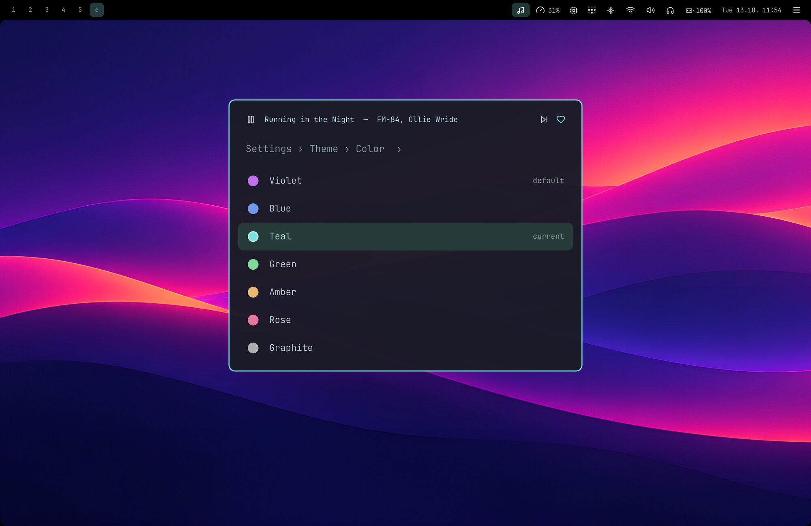

# Nightdrive

**A keyboard-driven Hyprland desktop for Apple Silicon Macs running Fedora Asahi Remix.**
Mac shortcuts, one launcher for everything, a top bar that behaves like the macOS menu bar, and a synthwave look you can
change in a click.


**Hi, I'm Jari Lehtinen.** I've used a Mac for over 20 years. Every year or so I've tried a Linux distro or two, but none of them quite
stuck. Omarchy came closest, but I wanted something built entirely around my own preferences and the apps I actually use.
In my day job as a web developer, user interfaces and ease of use are at the core of what I do, and that's what I wanted from
my desktop too: ⌘ shortcuts, a launcher like Spotlight, a menu bar that just works, only faster and lighter.
So I installed Fedora Asahi on my MacBook Pro and built Nightdrive, evening by evening and with a lot
of help from Claude Code.

> **Work in progress.** Nightdrive is my daily setup, published so others can use it or borrow from it. It has been tested on
> one machine so far (MacBook Pro 14″, M2 Max). Feedback, issues and ideas are very welcome.

## Why Nightdrive?

[Hyprland](https://hypr.land) is a great tiling compositor, but on its own it's a toolkit: no bar, launcher, theme or apps.
Nightdrive puts all of that together into one opinionated desktop.

- **⌘ is the main key.** ⌘C / ⌘V / ⌘X work in every app, including the terminal. ⌘W closes, ⌘Q quits, ⌘Space opens the launcher.
- **Built for the MacBook.** The top bar sits in the notch area. The display uses a clean 2× scale. The top-row keys control
  volume, brightness, the keyboard backlight and dictation. Caps Lock is a second ⌘. Sleep is tuned for Asahi.
- **Everything is a keystroke away.** One launcher handles apps, passwords, clipboard history, emoji, screenshots, settings,
  installing packages and power. You rarely need a terminal for everyday things.
- **Simple and readable.** Plain config files, a few small scripts, and comments that explain *why*.

## Highlights

### A launcher for everything

**⌘Space** opens the launcher. It holds apps, 1Password items (copy a password, username or one-time code), clipboard history,
an emoji picker, screenshots, a colour picker, every keybinding, settings, `dnf` install / remove, one-click updates, and
power actions. Search from the top level finds all of these. While music plays, a player row sits above the list. Type a
question and press ⌘⌥Enter to send it straight to Claude Code.


### A top bar that behaves like a menu bar

Click an icon and a small menu opens under it: sound and output devices, Wi-Fi, Bluetooth, battery and brightness, Tailscale,
headphone EQ, system load and temperatures, the calendar, notifications, music, and your **Claude usage limits**. ⌘⇧Space lets
you walk through the menus with the arrow keys.


### Make it yours in a click

Pick from seven theme colours: Violet, Blue, Teal, Green, Amber, Rose or Graphite. The colour changes the menus, launcher,
window borders, notifications, lock screen and top bar at once. Two synthwave wallpapers come with it, and you can add your own.
The top bar's items, opacity, and colours are all settings in the launcher.



### A drawer for what you want at hand

⌘S drops the active window into the drawer, and ⌘D slides the drawer up over your windows, dimming and blurring the rest.
⌘D again puts it away. ⌘S in the drawer sends the window back to the workspace and place it came from. It suits notes,
a to-do list or a chat you want one keystroke away without giving them a workspace of their own.


### Little things that add up

- **Shelf**: drag a file to the top edge of the screen to park it, then drag it into another app (like Dropover / Yoink).
- **Dictation**: hold F5 or Fn, speak, and let go. It runs fully offline with Voxtype and Parakeet ([setup](docs/dictation.md)).
- **Screen Mirroring**: mirror the screen to an Apple TV or an AirPlay TV from the display menu or the launcher (search
  "airplay"), with sound. Google Cast works from Chromium (⋮ › Cast…). Sharing the screen, for these and video calls, asks
  in a themed window: the whole screen or one window.
- **Screensavers**: a synthwave sunset and a falling-characters rain, both drawn in the terminal, and a big clock whose
  digits slide up as the minutes change.
- **Background apps**: ⌘W only hides chat apps and the music player, so they keep running. Their shortcut brings them straight back.
- **Web apps**: turn any site into an app window from the launcher (System › Install › Webapp).
- **Installing apps**: System › Install › Software searches Fedora's packages and Flathub's apps at once, one row per app (Fedora's
  when both have it, Tab in the details takes Flathub's), command-line tools below; details before installing. Remove lists both.
- **Login apps**: you choose what starts at login in the launcher (Settings › Startup, or ⌥Enter on an app). Background
  apps start hidden. Only 1Password is on by default, because its SSH agent and the Passwords level need it.
- **Login screen**: a password-only greeter that matches the theme (`--no-greeter` keeps the distribution's own).


## What's included

| | App | How it fits in |
|---|---|---|
| Window manager | [Hyprland](https://hypr.land) | Lua config, Mac-style keybindings, rounded screen corners |
| Bar, menus, launcher | [Quickshell](https://quickshell.org) | one themed shell for the top bar, its menus, launcher, OSD and shelf |
| Terminal | [kitty](https://sw.kovidgoyal.net/kitty/) | ⌘Enter; Mac copy and paste |
| Browser | Firefox | tabs below the address bar, themed UI |
| Mail | Thunderbird | themed, with a minimal toolbar ([details](docs/thunderbird.md)) |
| Music | [Deck](https://github.com/jarilehtinen/deck) (Spotify in the terminal) | bar icon, music menu, player row in the launcher, media keys |
| Passwords | 1Password + `op` CLI | Passwords level in the launcher, SSH agent |
| AI | [Claude Code](https://claude.com/claude-code) | ⌘⌥Enter, ask from the launcher, usage limits in the bar |
| Dictation | [Voxtype](https://github.com/peteonrails/voxtype) (Parakeet) | F5 / Fn push-to-talk, recording card on screen |
| Network | NetworkManager, BlueZ, [Tailscale](https://tailscale.com) | Wi-Fi, Bluetooth and Tailscale menus |
| Audio | PipeWire, [EasyEffects](https://github.com/wwmm/easyeffects) | output switching (AirPlay speakers too), EQ presets for headphones |
| Screen Mirroring | [doubletake](https://github.com/omarroth/doubletake) (AirPlay, built by `install-doubletake.sh`) | Settings › Display; experimental, picture limited to 1080p (no hardware encoder on Asahi) |
| Notifications | Quickshell | app icon and time on every notification, history and do not disturb in the bar |
| Files and images | Nautilus, Loupe | images open in Loupe, a simple viewer like Preview |
| Markdown | [Apostrophe](https://apps.gnome.org/Apostrophe/) (Flatpak) | `.md` files open in it, themed editor |
| Messaging | [Telegram Desktop](https://desktop.telegram.org) (Flatpak) | native Wayland app |
| Web apps | Chromium app windows | WhatsApp, Slack, Teams and YouTube by default; add your own |
| Lock and idle | hyprlock, hypridle | screensaver after 10 min, lock after 30 min (screensaver and screen-off times: Settings › Screensaver) |
| Smart home (optional) | [Home Assistant](https://www.home-assistant.io) (`install-home-assistant.sh`) | Home in the launcher: rooms and their devices (Enter turns one on/off or runs a scene, "olohuone kattovalo" finds it from the search), pinned devices in the top bar's Home menu, the webapp; local, Tailscale and Nabu Casa addresses tried in order |
| Optional | VS Code, Jottacloud | `install-vscode.sh`, `install-jotta.sh` |

## Requirements

- An **Apple Silicon Mac** (M1 or M2 series) with **[Fedora Asahi Remix](https://asahilinux.org/fedora/) 44**, the KDE edition.
- Tested on a MacBook Pro 14″ with an M2 Max. Other models should work, but you may need to adjust a few values (see
  [Make it yours](#make-it-yours)).

## Install

On a fresh Fedora Asahi Remix 44 with a network connection:

```sh
sudo dnf install -y git   # not in a fresh install
git clone https://github.com/jarilehtinen/nightdrive.git ~/dotfiles
cd ~/dotfiles
./install.sh              # system update, packages, fonts, 1Password, the notch setting, config links, Deck, login screen,
                          # and removes the KDE apps and services Nightdrive doesn't use (packages-remove.txt)
```

Then **reboot**. The Nightdrive login screen (greetd + Quickshell) starts Hyprland; KDE stays installed as a fallback. If the
login screen fails, press Ctrl+Alt+F3, log in and run `config/greeter/switch.sh off`.

| Option | What it changes |
|---|---|
| `--no-greeter` | Keeps the KDE login screen; pick **Hyprland** there (not *Hyprland (uwsm-managed)*) |
| `--keep-apps` | Keeps the KDE apps, printing, network shares, accessibility tools and other packages listed in `packages-remove.txt` (comment a line out to keep just that one) |
| `--no-kde` | Removes Plasma completely (experimental) |
| `--vm` | For trying Nightdrive in a Fedora 44 VM instead of an Asahi Mac ([docs/vm.md](docs/vm.md)) |

A few things stay manual:
- `sudo tailscale up`
- In 1Password › Settings › Developer, turn on *SSH agent* and *Integrate with 1Password CLI*. The launcher's Passwords level
  needs the CLI integration.
- Sign in to Spotify in Deck.
- Open Firefox and Thunderbird once and run `./link.sh` again: it themes their profiles, which don't exist before the first start.
- Optionally, set up dictation ([docs/dictation.md](docs/dictation.md)).

`./link.sh` on its own just (re)links the config files and is safe to run again. The repo can live anywhere; `~/dotfiles` is
only a convention.

### Updating

Nightdrive checks for new changes every six hours and shows a notification with an **Update** button when there are some.
You can also update any time from the launcher (**Update**) or a terminal:

```sh
nightdrive update   # pulls Nightdrive (and Deck), relinks, installs new packages, updates the system, reloads the desktop
```

It never overwrites your own edits: a repo with uncommitted changes is skipped with a note. On an install older than the
command, run it once as `~/dotfiles/bin/nightdrive update` (a plain `git pull` misses the new links and packages).

The same `nightdrive` command reaches the settings from a terminal (`nightdrive` alone lists everything):

| Command | What it does |
|---|---|
| `nightdrive update` | Updates Nightdrive and the system (above) |
| `nightdrive update check` | Only looks for new changes (what the six-hourly check runs) |
| `nightdrive theme color teal` | Theme colour: violet, blue, teal, green, amber, rose or graphite |
| `nightdrive wallpaper set <image>` | Changes the wallpaper; `nightdrive wallpaper current` prints it |
| `nightdrive display list` | Each screen's even scales; `nightdrive display scale eDP-1 2` sets one |
| `nightdrive bar-style opacity 80` | Top bar opacity; also `icons`, `icon-opacity` and `highlight` |
| `nightdrive topbar adjust` | Top bar icon sizes and positions, a pixel at a time, live |

## Keys

⌘ is the Super key, and Caps Lock works as a second ⌘.

| Keys | Action |
|---|---|
| ⌘ Space · ⌘ Enter | Launcher · terminal |
| ⌘ ⌥ Enter | Claude Code (with text typed in the launcher: sends it as the prompt) |
| ⌘ C / V / X | Copy / paste / cut, in every app |
| ⌘ W · ⌘ Q | Close (background apps are only hidden) · really quit |
| ⌘ F · ⌘ T · ⌘ J | Fullscreen · floating · split direction |
| ⌘ 1…0 · ⌘ ⇧ 1…0 | Go to workspace · move the window there |
| ⌘ D · ⌘ S | Drawer: show / hide · put the window in it, or take it back out |
| ⌘ ⇧ V · ⌘ ⇧ E | Clipboard history · emoji |
| ⌘ R · ⌘ ⇧ R | Screenshot of a region · of a window, to the clipboard |
| ⌘ ⇧ B / F / P / M / I | Browser / Files / 1Password / Music / Mail |
| ⌘ ⇧ Space | Walk through the top bar menus with the keyboard |
| ⌘ Esc | Notifications |
| F5 or Fn (hold) | Dictation |
| ⌘ ⇧ K | All shortcuts (also in the launcher under *Keybindings*) |

The full list is in [`config/hypr/SHORTCUTS.md`](config/hypr/SHORTCUTS.md).

## Make it yours

- **Machine settings.** The keyboard layout (Finnish Mac) and the default display scale are at the top of
  [`config/hypr/hyprland.lua`](config/hypr/hyprland.lua). These are the first things to change. A scale picked in the
  launcher (Settings › Display) wins over the default.
- **Per-machine overrides** go to `config/hypr/local.lua`, which git ignores.
- **Keybindings** are all in [`config/hypr/bindings.lua`](config/hypr/bindings.lua).
- **Web apps** are listed in [`config/webapps.txt`](config/webapps.txt). Apps that ⌘W should only hide are in
  [`config/hypr/background-apps`](config/hypr/background-apps).
- **Launcher apps**: only the apps in [`config/fuzzel/apps-allow.txt`](config/fuzzel/apps-allow.txt) are listed. Search finds
  the rest.
- **Private additions**: some things don't belong in a public repo, like work tools or a personal dashboard. You can keep them in
  your own private repo and link them into git-ignored *local* slots. Nightdrive loads them when they exist:

  | Slot | What you can add there |
  |---|---|
  | `config/hypr/local.d/*.lua` | autostart entries, window rules, keybindings |
  | `config/hypr/background-apps.local`, `SHORTCUTS.local.md` | more background apps, your own entries in the shortcut list |
  | `config/quickshell/local/` | `<Name>Menu.qml` bar menus, and `LauncherExtension.qml` for your own launcher levels |
  | `config/fuzzel/apps-allow.local.txt` | more apps shown in the launcher |
  | `config/topbar/local.modules.jsonc`, `status.local`, `local.adjust.conf` | your own bar modules (at the left end of the icons), their status and icon sizes |

## How it fits together

- **Quickshell** draws the top bar and its menus. The modules are listed in `config/topbar/modules.jsonc`. Each one gets its
  state from `config/topbar/scripts/status <name>` (an icon name, a text and a class), and a click opens `<Name>Menu.qml`
  under it. Icons are SVGs: Lucide by name, or `pack:name` from any [Iconify](https://icon-sets.iconify.design) set (fetched
  once). Sizes and positions are in `config/topbar/adjust.conf`.
- The menus use ordinary command-line tools such as `wpctl`, `nmcli`, `bluetoothctl`, `upower`, `tailscale`, `cliphist` and `dnf`.
  There are no daemons of their own.
- The theme script (`config/hypr/scripts/theme`) derives every shade from one colour. It writes a small file for Quickshell,
  fuzzel and hyprlock, then reloads them.
- Deck writes its playing state to a small JSON file. The bar, the music menu and the launcher read that file.

## Good to know

- **Known issues** that have a workaround but no fix in Nightdrive yet are in [docs/known-issues.md](docs/known-issues.md).
- **Hyprland isn't in Fedora's aarch64 repositories.** The installer takes the `hypr*` packages from the COPR `arcaneon/arcos`
  and limits that repository to them.
- **Asahi specifics.** The notch area needs the `appledrm.show_notch=1` kernel argument, which the installer sets. The 16 KiB memory
  pages break a few Electron apps, but 1Password works.
- **The Claude usage menu** reads your plan's limits with Claude Code's own sign-in, so Claude Code must have been run once.
- **No credentials are stored in this repo.** Tokens stay with each app (Deck, Claude Code) or in 1Password.

## Want to participate?

Nightdrive is work in progress, and help of almost any kind moves it forward:

- **Try it on your Mac.** It has only been tested on a MacBook Pro 14″ with M2 Max. A report from any other Apple Silicon
  model is valuable (in Discussions), whether everything worked or something broke.
- **Ask or share in [Discussions](https://github.com/jarilehtinen/nightdrive/discussions):** questions, ideas, how it runs
  on your Mac, or a screenshot of your setup.
- **Open an [issue](https://github.com/jarilehtinen/nightdrive/issues)** for a bug or a rough edge. A screenshot or the output
  of the failing command helps a lot.
- **Send a pull request.** Keep it small and in the spirit of the rest: plain files, comments that explain *why*, and nothing
  personal (that goes in the git-ignored local slots, see [Make it yours](#make-it-yours)). [`AGENTS.md`](AGENTS.md) has the
  working notes, handy for people and coding agents alike.
- **Make wallpapers.** See below.

## Credits

Inspired by [Omarchy](https://omarchy.org). Built on [Hyprland](https://hypr.land) and [Quickshell](https://quickshell.org), on top of the [Asahi Linux](https://asahilinux.org) team's work. The colours start
from the [Tokyo Night](https://github.com/enkia/tokyo-night-vscode-theme) palette, and the icons are [Lucide](https://lucide.dev) (ISC).
The wallpapers were made with ChatGPT image generation for now. I'd much rather ship wallpapers by real artists, so if you make
synthwave art (or know someone who does) and would like it included, please get in touch in Discussions. The Tailscale logo in the bar is Tailscale's trademark.

## License

[MIT](LICENSE). The bundled Lucide icon font and icons are ISC-licensed.
