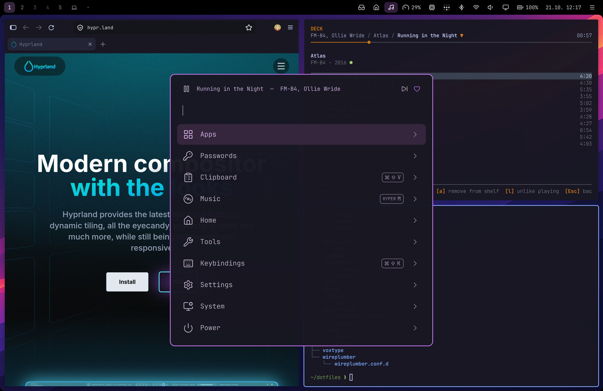
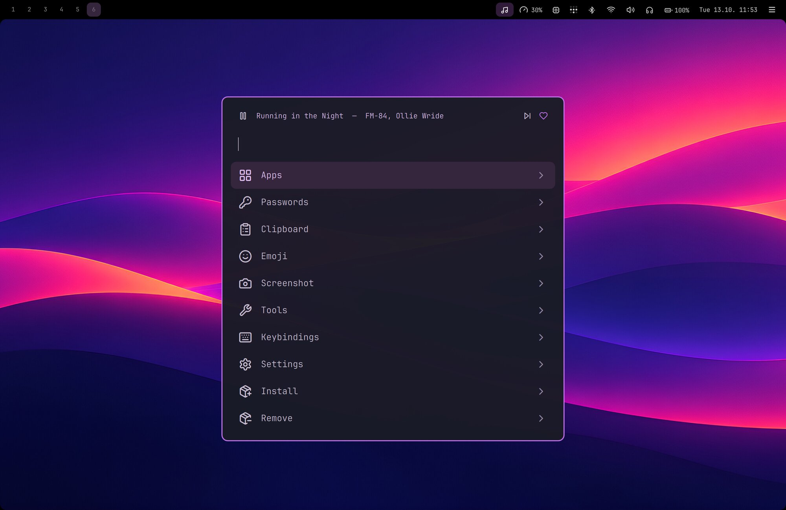
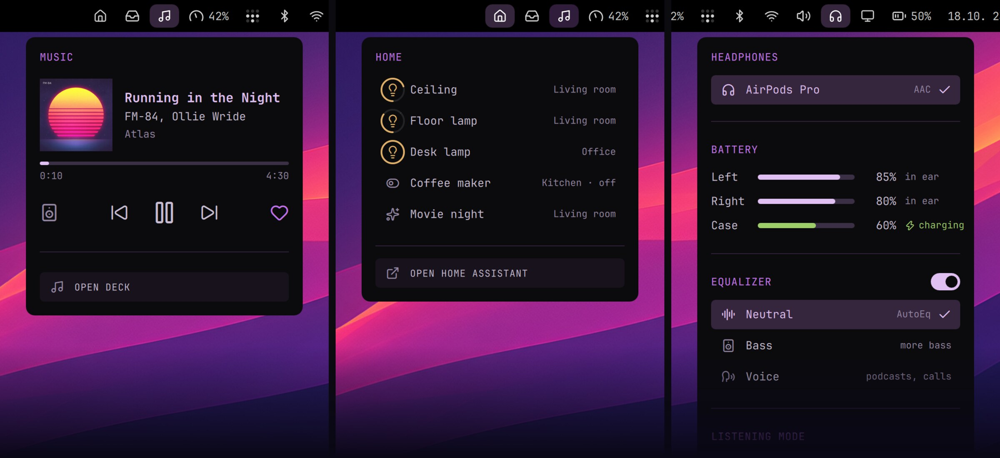
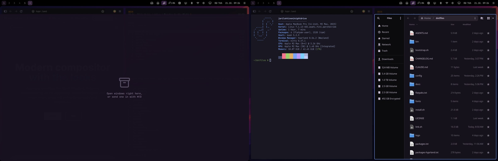
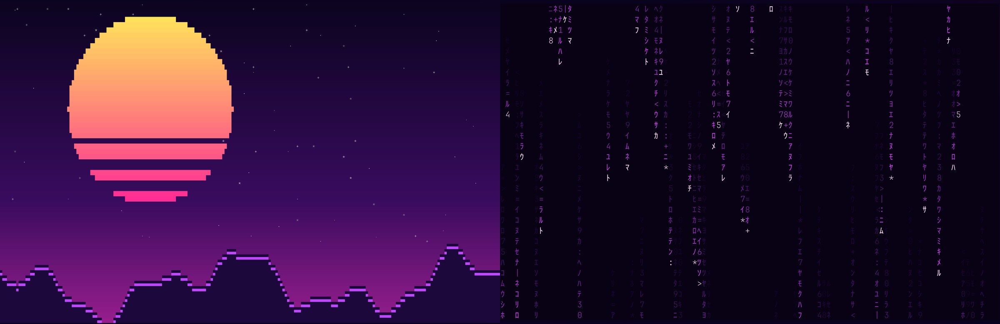

# Nightdrive

**A keyboard-driven Hyprland desktop for Fedora, on an Apple Silicon Mac (Fedora Asahi Remix) or a PC.**
Mac-style ⌘ shortcuts, one launcher for everything, a top bar of thoughtful little menus, and a synthwave look.



**Hi, I'm [Jari Lehtinen](https://github.com/jarilehtinen).** I've used a Mac for over 20 years. Every year or so I've tried a Linux distro or two, but none of them quite
stuck. Omarchy came closest, but I wanted something built entirely around my own preferences and the apps I actually use.
In my day job as a web developer, user interfaces and ease of use are at the core of what I do, and that's what I wanted from
my desktop too: ⌘ shortcuts, a launcher like Spotlight, a menu bar that just works, only faster and lighter.
So I installed Fedora Asahi on my MacBook Pro and built Nightdrive, evening by evening and with a lot
of help from Claude Code.

> **Work in progress.** Nightdrive is my daily setup, published so others can use it or borrow from it. It's used every day on
> a MacBook Pro 14″ (M2 Max) and tested in a virtual machine; PC support is new and not yet tested on real PC hardware.
> Feedback, issues and ideas are very welcome.

## Why Nightdrive?

[Hyprland](https://hypr.land) is a great tiling compositor, but on its own it's a toolkit: no bar, launcher, theme or apps.
Nightdrive puts all of that together into one opinionated desktop.

- **⌘ is the main key.** ⌘ is the Super key: Command on a Mac, the Windows key on a PC.
  ⌘C / ⌘V / ⌘X work in every app, including the terminal. ⌘S saves, ⌘W closes, ⌘Q quits, ⌘Space opens the launcher.
- **Caps Lock is Hyper, the app key.** Hyper + a letter opens an app or brings it to the front: Hyper+B the browser,
  Hyper+F Files, Hyper+M music. No app uses Hyper itself, so the keys are yours: pick the app for any letter or digit
  in the launcher (Settings › Keyboard Shortcuts).
- **Fits the machine it's on.** The installer recognises an Apple Silicon Mac, a PC or a virtual machine and sets it up to
  match: the keyboard layout you picked when installing Fedora, the graphics driver (NVIDIA too), the display scale. On a
  MacBook the top bar sits in the notch area, the top-row keys control volume, brightness, the keyboard backlight and
  dictation, and sleep is tuned for Asahi.
- **Everything is a keystroke away.** One launcher handles apps, passwords, clipboard history, emoji, screenshots, settings,
  installing packages and power. You rarely need a terminal for everyday things.
- **Simple and readable.** Plain config files, a few small scripts, and comments that explain *why*.

## Highlights

### A launcher for everything

**⌘Space** opens the launcher. It holds apps, 1Password items (copy a password, username or one-time code), clipboard history,
an emoji picker, screenshots, a colour picker, every keybinding, settings, `dnf` install / remove, one-click updates, and
power actions. Search from the top level finds all of these. While music plays, a player row sits above the list. Type a
question and press ⌘⌥Enter to send it straight to Claude Code.



### Menus you want to click

Click an icon and a small menu opens under it: sound and output devices, Wi-Fi, Bluetooth, battery and brightness, Tailscale,
headphone EQ, system load and temperatures, the calendar, notifications, music, and your **Claude usage limits**. ⌘⇧Space lets
you walk through the menus with the arrow keys.



### Apps without a terminal, and only the parts you want

System › Install › Software in the launcher searches Fedora's packages and Flathub's apps at once, one row per app (Fedora's
when both have it, Tab in the details takes Flathub's), with command-line tools below and the details before installing.
Browse has Popular (top 100) and categories: Flathub's most installed apps that your machine can run (ARM or x86). System ›
Remove has Software (both) and Webapps, and its search looks in both.

Everything beyond the core is an optional part you choose when installing, or later under System › Install: apps Nightdrive
sets up (1Password, Deck, Home Assistant…), ready-made web apps with a keybinding, and plugins for desktop features. A part
that isn't installed doesn't show anywhere: no launcher level, bar icon or keybinding.

Updates come in a notification with an **Update** button, which updates Nightdrive and the system in one go.

### A drawer for what you want at hand

⌘⇧D drops the active window into the drawer, and ⌘D slides the drawer up over your windows, dimming and blurring the rest.
⌘D again puts it away. ⌘⇧D in the drawer sends the window back to the workspace and place it came from. It suits notes,
a to-do list or a chat you want one keystroke away without giving them a workspace of their own.



### Little things that add up

- **Shelf**: drag a file to the top edge of the screen to park it, then drag it into another app (like Dropover / Yoink).
- **Dictation**: hold F5 (or Fn on a Mac), speak, and let go. It runs fully offline with Voxtype and Parakeet ([setup](docs/dictation.md)).
- **Snippets**: text snippets in launcher › Tools › Snippets; Enter pastes one. Turn on auto-expand and typing a trigger
  anywhere replaces it with the text.
- **From your phone** (experimental plugins): [LocalSend](plugins/localsend/README.md) receives files from a phone after
  you accept them in a notification, and [AirPlay Receiver](plugins/airplay-receiver/README.md) mirrors an iPhone, iPad or
  Mac into a window. [Ferry](plugins/ferry/README.md) is a
  mailbox over Tailscale: drop files on its top bar icon and they wait for the phone, which needs no app, only a web page
  on its Home Screen.
- **[Screen Mirroring](plugins/mirroring/README.md)**: mirror the screen to an Apple TV or an AirPlay TV from the display menu or the launcher (search
  "airplay"), with sound. Google Cast works from Chromium (⋮ › Cast…). Sharing the screen, for these and video calls, asks
  in a themed window: the whole screen or one window.
- **Themes**: seven colours that change the whole desktop at once, two synthwave wallpapers and your own (Settings › Theme).
- **Screensavers**: a synthwave sunset and a falling-characters rain, both drawn in the terminal, and a big clock whose
  digits slide up as the minutes change.
- **Background apps**: ⌘W only hides chat apps and the music player, so they keep running. Their shortcut brings them straight back.
- **Closed by mistake?** ⌘⇧U opens the window you closed with ⌘W again, in the same place. A terminal comes back in the
  same folder, with Claude Code in the same conversation. Press again for the one before it.
- **Web apps**: turn any site into an app window from the launcher (System › Install › Webapp), and remove one in System ›
  Remove › Webapps (its logins go with it). Their notifications come with the web app's own name and icon, not Chromium's.
- **Default apps**: which app opens links, mail, folders, text, code, images, video, music, PDFs and calendar files, in the launcher
  (Settings › Default apps, or `nightdrive defaults`). Hyper B, F and E open the browser, Files and Email you chose.
- **Keyboard Shortcuts**: which app Hyper + a letter or digit opens, in the launcher (Settings › Keyboard Shortcuts, or
  `~/.config/hypr/scripts/app-keys`). Your choice replaces a default, Nightdrive's or a plugin's, and the key list shows
  it. The other shortcuts are in the config files ([Make it yours](#make-it-yours)).
- **Login apps**: you choose what starts at login in the launcher (Settings › Startup, or ⌥Enter on an app). Background
  apps start hidden. Only 1Password (if installed) is on by default, because its SSH agent and the Passwords level need it.
- **Login screen**: a password-only greeter that matches the theme (`--no-greeter` keeps the distribution's own).



## What's included

| | App | How it fits in |
|---|---|---|
| Window manager | [Hyprland](https://hypr.land) | Lua config, Mac-style keybindings, rounded screen corners |
| Bar, menus, launcher | [Quickshell](https://quickshell.org) | one themed shell for the top bar, its menus, launcher, OSD and shelf |
| Terminal | [kitty](https://sw.kovidgoyal.net/kitty/) | ⌘Enter, opens in `~/Projects`; Mac copy and paste |
| Browser | Firefox | tabs below the address bar, themed UI |
| Mail (optional) | Thunderbird | themed, with a minimal toolbar ([details](docs/thunderbird.md)) |
| Music (optional) | [Deck](plugins/deck/README.md) (Spotify in the terminal, needs Spotify Premium) | bar icon, music menu, player row in the launcher, media keys |
| Passwords (optional) | [1Password](plugins/1password/README.md) + `op` CLI | Passwords level in the launcher, SSH agent |
| AI | [Claude Code](https://claude.com/claude-code) (the installer sets it up; log in once with `claude`) | ⌘⌥Enter in `~/Projects`, ask from the launcher, usage limits in the bar |
| Dictation | [Voxtype](https://github.com/peteonrails/voxtype) (Parakeet) | F5 / Fn push-to-talk, recording card on screen |
| Network | NetworkManager, BlueZ, [Tailscale](plugins/tailscale/README.md) (optional) | Wi-Fi, Bluetooth and Tailscale menus |
| Audio | PipeWire, [EasyEffects](https://github.com/wwmm/easyeffects) | output switching (AirPlay speakers too), EQ presets for headphones; Sony and AirPods listening mode, AirPods battery per pod and case and their own settings |
| Screen Mirroring (optional) | [doubletake](https://github.com/omarroth/doubletake) (AirPlay, built by `plugins/mirroring/install.sh`) | Settings › Display; experimental, picture limited to 1080p (no hardware encoder on Asahi) |
| Notifications | Quickshell | app icon and time on every notification, its app's buttons in the popup and in the history (until the app closes it), history and do not disturb in the bar; a warning with the charge left when the battery drops to 10 % and 5 % (gone once the charger is in); how long they show and their sounds in launcher › Settings › Notifications, where crash reports can be turned on: when an app crashes, Ask Claude finds out why |
| Files and images | Nautilus, Loupe | images open in Loupe, a simple viewer like Preview |
| Markdown (optional) | [Apostrophe](https://apps.gnome.org/Apostrophe/) (Flatpak) | `.md` files open in it, themed editor |
| Messaging | [Telegram Desktop](https://desktop.telegram.org) (Flatpak, install it from Install › Software) | native Wayland app, keeps running in the background like 1Password |
| Web apps | Chromium app windows | add your own, or a ready-made one with a keybinding: WhatsApp, Slack, Teams, YouTube (Install › Webapp) |
| External display | Hyprland | workspaces 1–9 on the external display, one on the laptop's screen (⌘0, a laptop icon in the bar); with the lid closed only the external display is used, and the login screen shows on the screen you're on |
| Lock and idle | the login screen as the lock (Quickshell), hypridle | screensaver after 10 min, lock after 30 min (screensaver and screen-off times: Settings › Screensaver) |
| Smart home (optional) | [Home Assistant](plugins/home-assistant/README.md) | Home in the launcher: rooms and their devices, Enter turns one on/off or runs a scene, ←/→ sets a light's brightness; pinned devices in the top bar's Home menu; the webapp. Local, Tailscale and Nabu Casa addresses tried in order |
| Phone (optional) | [LocalSend](https://localsend.org) receiver, [UxPlay](https://github.com/FDH2/UxPlay), Ferry (own, over `tailscale serve`) | files and text from a phone, asked first in a notification; an iPhone, iPad or Mac mirrored into a window; a mailbox both ways with a web page and Web Push. All experimental |
| [Mac Keyboard Shortcuts](plugins/keyd/README.md) (optional) | [keyd](https://github.com/rvaiya/keyd), a Nautilus extension | ⌥⌫ deletes a word, ⌘⌫ to the line start; Files like Finder: Enter renames, ⌘O opens, ⌘⌫ to the trash |
| Optional parts | everything marked optional above, Jottacloud, VS Code | chosen when installing; the rest later in launcher › System › Install (Recommended: apps Nightdrive sets up; Webapp; Plugins: desktop features like Screen Mirroring) or `nightdrive plugins` (`plugins.txt` and [`plugins/`](plugins/README.md)). A part that isn't installed doesn't show anywhere: no launcher level, bar icon or keybinding. One installed later (the launcher, `dnf`, Flatpak) shows up by itself |

## Requirements

One of these, with the KDE edition of Fedora 44. The installer tells which machine it's on and sets it up to match.

- An **Apple Silicon Mac** (M1 or M2 series) with **[Fedora Asahi Remix](https://asahilinux.org/fedora/) 44**. Used daily
  on a MacBook Pro 14″ with an M2 Max; other models should work, but you may need to adjust a few values (see
  [Make it yours](#make-it-yours)).
- A **PC** (x86_64) with **[Fedora 44 KDE](https://fedoraproject.org/kde/download)** and NVIDIA, AMD or Intel graphics.
  Experimental, see [docs/pc.md](docs/pc.md) for what differs from the MacBook.
- A Fedora 44 **virtual machine**, e.g. in Parallels on a Mac ([docs/vm.md](docs/vm.md)).

## Install

On a fresh Fedora Asahi Remix 44 or Fedora 44 KDE, with a network connection:

```sh
curl -fsSL https://nightdrive.sh/install | bash
```

That runs [`bootstrap.sh`](bootstrap.sh): it installs git, clones Nightdrive into `~/dotfiles` and starts its installer.
`bash -s -- --dev` clones the dev channel instead of the stable one, and the installer's options in the table below go
after `--` too (`bash -s -- --with deck`). The same by hand:

```sh
sudo dnf install -y git   # not in a fresh install
git clone https://github.com/nightdrive-sh/nightdrive.git ~/dotfiles
cd ~/dotfiles
./install.sh              # asks which optional parts to install, then: removes the KDE apps and services Nightdrive
                          # doesn't use (packages-remove.txt), system update, packages, fonts, the notch setting,
                          # config links, Claude Code, login screen and the optional parts
```

It tells which machine it's on and asks first which optional parts you want (number toggles one, Enter continues):

```
Machine: PC (x86_64, graphics: amd, keyboard: us)

  Recommended apps
   1 [ ] 1Password         Password manager: launcher › Passwords, op CLI, SSH agent
   2 [x] Deck              Spotify player (needs Premium), launcher and top bar; compiled
   3 [x] Tailscale         VPN, in the top bar (log in afterwards: sudo tailscale up)
   …

  Web apps
   9 [ ] Slack             Slack as a web app (Hyper+S)
   …

  Plugins
  13 [ ] AirPlay Receiver  Mirror an iPhone, iPad or Mac here (UxPlay, experimental)
  14 [ ] Ferry             Files and text both ways with your phone over Tailscale, no app (experimental)
  15 [ ] Mac Keyboard Shortcuts ⌥⌫ deletes a word, ⌘⌫ to the line start; Files: Enter renames, ⌘O opens, ⌘⌫ to the trash
   …

  18 [ ] Install all       every optional part above

  19 [x] Remove apps       112 installed packages Nightdrive doesn't use: akregator dolphin konsole kmail …
```

**Trying it on the system you already use?** The removals are on by default only on a fresh install (one installed less
than three days ago). On an older system the *Remove apps* row starts unticked, and nothing else is removed: your configs
in `~/.config` are moved aside to `<name>.bak-<time>`, and `config/greeter/switch.sh off` brings back the KDE login screen.

After that it runs unattended (sudo asks for the password once at the start); the system update and compiling Deck take a
while. Home Assistant, if chosen, asks for its address and token at the very end. Anything you skip can be added later from
the launcher (System › Install) or with `nightdrive plugins install ID`.

Then **reboot**. The Nightdrive boot splash goes straight over to the Nightdrive login screen (greetd + Quickshell): the
desktop starts behind it as its lock, so the screen changes hands only once and doesn't flash black. The login apps start
after the password. KDE stays installed as a fallback. If the login screen fails, press Ctrl+Alt+F3, log in and run
`config/greeter/switch.sh off`. `switch.sh on` gives the plain login screen that starts the desktop after the password.

| Option | What it changes |
|---|---|
| `--no-greeter` | Keeps the KDE login screen; pick **Hyprland** there (not *Hyprland (uwsm-managed)*) |
| `--no-autologin` | The Nightdrive login screen starts the desktop after the password, instead of being its lock (black flashes at boot) |
| `--no-splash` | Keeps Fedora's boot splash and the GRUB menu (`config/splash/install.sh off` later) |
| `--keep-apps` | Keeps the KDE apps, printing, network shares, accessibility tools and other packages listed in `packages-remove.txt` (comment a line out to keep just that one) |
| `--debloat` | Removes them also on a system that isn't fresh (without a terminal, or with `--defaults` and the like, nothing is asked) |
| `--no-kde` | Removes Plasma completely (experimental) |
| `--vm` | The virtual machine settings, if the VM isn't detected as one ([docs/vm.md](docs/vm.md)) |
| `--no-nvidia` | On a PC, leaves an NVIDIA card's driver alone instead of installing RPM Fusion's ([docs/pc.md](docs/pc.md)) |
| `--with deck,1password` | These optional parts on top of the defaults, without asking (`--dry-run` lists the ids) |
| `--without youtube` | The defaults without these, without asking; combines with `--with` |
| `--all` / `--none` / `--defaults` | Every optional part / none / the defaults (Tailscale, Deck, YouTube), without asking |
| `--dry-run` | Shows the optional parts, what would be installed and what would be removed, then stops |

A few things stay manual (the install lists the ones for the parts you chose):
- Tailscale: `sudo tailscale up`
- 1Password: in Settings › Developer, turn on *SSH agent* and *Integrate with 1Password CLI*. The launcher's Passwords level
  needs the CLI integration.
- Deck: sign in to Spotify (needs Premium and the Client ID of your own Spotify app, see Deck's README).
- Open Firefox (and Thunderbird) once and run `./link.sh` again: it themes their profiles, which don't exist before the first start.
- Optionally, set up dictation ([docs/dictation.md](docs/dictation.md)).
- More optional parts: launcher › System › Install (Recommended, Webapp, Plugins), or `nightdrive plugins`. Each opens its
  installer in a terminal (a ready-made web app is added right away); running one again is safe.

`./link.sh` on its own just (re)links the config files and is safe to run again. The repo can live anywhere; `~/dotfiles` is
only a convention.

### Updating

Nightdrive checks for new changes every six hours and shows a notification with an **Update** button when there are some.
You can also update any time from the launcher (**Update**) or a terminal:

```sh
nightdrive update   # pulls Nightdrive (and Deck), relinks, installs new packages, updates the system, reloads the desktop
```

It never overwrites your own edits: a repo with uncommitted changes is skipped with a note. On an install older than the
command, run it once as `~/dotfiles/bin/nightdrive update` (a plain `git pull` misses the new links and packages).

Updates come from the **Stable** channel (the `main` branch) unless you pick **Development** (`dev`), which gets every
change first, before it is tested and released into Stable: in the launcher under **Settings › Update channel**, or `nightdrive channel dev`
(`nightdrive channel stable` goes back). Switching stops with a note instead of going over your own changes.

Stable gets the changes as releases, each with notes on what's new: an update that brings one shows its notes at the end,
`nightdrive version` tells which release you have, and every release is in the [changelog](CHANGELOG.md).

The same `nightdrive` command reaches the settings from a terminal (`nightdrive` alone lists everything):

| Command | What it does |
|---|---|
| `nightdrive update` | Updates Nightdrive and the system (above) |
| `nightdrive update check` | Only looks for new changes (what the six-hourly check runs) |
| `nightdrive channel` | The update channel, stable or dev; `nightdrive channel dev` switches to it |
| `nightdrive version` | The release you have, and the channel |
| `nightdrive theme color teal` | Theme colour: violet, blue, teal, green, amber, rose or graphite |
| `nightdrive wallpaper set <image>` | Changes the wallpaper; `nightdrive wallpaper current` prints it |
| `nightdrive display list` | Each screen's even scales; `nightdrive display scale eDP-1 2` sets one |
| `nightdrive bar-style opacity 80` | Top bar opacity; also `icons`, `icon-opacity` and `highlight` |
| `nightdrive topbar adjust` | Top bar icon and text sizes, half a pixel at a time, live |
| `nightdrive topbar date dmy` | The clock's date: `dmy` 19.10., `mdy` 10/19, `iso` 10-19 or `auto` (the system language's order); also launcher › Settings › Top bar › Date format |
| `nightdrive plugins` | Optional parts and whether each is installed and on; `nightdrive plugins install home-assistant` runs one's installer |
| `nightdrive plugins off ferry` | Hides an installed part from the desktop and stops its services, for one that misbehaves (`on` brings it back; also the switch on its page in the launcher) |
| `nightdrive plugins add <git-url>` | Adds a plugin from someone else's repo, marked external in the launcher; `nightdrive update` keeps it up to date, `nightdrive plugins remove ID` deletes it |

## Keys

⌘ is the Super key (Command on a Mac, the Windows key on a PC). Hyper is Caps Lock: Hyper + a letter opens an app, and
which app is yours to choose (launcher › Settings › Keyboard Shortcuts).

| Keys | Action |
|---|---|
| ⌘ Space · ⌘ Enter | Launcher · terminal |
| ⌘ ⌥ Enter | Claude Code (with text typed in the launcher: sends it as the prompt) |
| ⌘ C / V / X · ⌘ S | Copy / paste / cut, in every app · save |
| ⌘ W · ⌘ Q · ⌘ ⇧ U | Close (background apps are only hidden) · really quit · open the closed window again |
| ⌘ ⇧ F · ⌘ ⇧ T · ⌘ ⇧ J | The window: fullscreen · tile or float · split direction (⌘ ⇧ arrows move it) |
| ⌥ Tab · ⌥ ⇧ Tab | The app's next · previous window |
| ⌘ F · ⌘ T · ⌘ J | The app's own: find · new tab · downloads |
| ⌘ 1…0 · ⌘ ⇧ 1…0 | Go to workspace · move the window there |
| ⌘ D · ⌘ ⇧ D | Drawer: show / hide · put the window in it, or take it back out |
| ⌘ ⇧ V · ⌘ ⇧ E | Clipboard history · emoji |
| ⌘ R · ⌘ ⇧ R | Reload · without the cache (browsers) |
| ⌘ ⇧ S · ⌘ ⌥ S · ⌘ ⌥ ⇧ S | Screenshot of a region · of a window · of the screen, to the clipboard |
| Hyper B / F / P / M / E | Browser / Files / 1Password / Music / Email |
| ⌘ ⇧ Space | Walk through the top bar menus with the keyboard |
| ⌘ + drag | On a top bar icon: move it to another place in the bar |
| ⌘ Esc | Notifications |
| F5 (hold; Fn on a Mac) | Dictation |
| ⌘ ⇧ K | All shortcuts (also in the launcher under *Keybindings*) |

The full list is in [`config/hypr/SHORTCUTS.md`](config/hypr/SHORTCUTS.md).

## Make it yours

- **Machine settings.** The defaults at the top of [`config/hypr/hyprland.lua`](config/hypr/hyprland.lua) are for a
  MacBook's display (scale 2) and a Finnish Mac keyboard. The installer writes the machine's own into
  `config/hypr/local.lua`: on a PC the display scale picked automatically and the keyboard layout Fedora's installer
  set, in a VM settings for it, on a Mac the layout unless it's Finnish. The login screen uses the same layout. A scale picked in the
  launcher (Settings › Display) wins over both.
- **Per-machine overrides** go to `config/hypr/local.lua`, which git ignores.
- **Keybindings** are in [`config/hypr/bindings.lua`](config/hypr/bindings.lua), a plugin's in its own folder. Apps
  open with Hyper (Caps Lock, `MOD3`) + a letter, chosen in the launcher (Settings › Keyboard Shortcuts); a Hyper key
  bound in `local.lua` (`hl.bind("MOD3 + D", …)`) is a default that a choice there replaces.
- **Optional parts** (recommended apps, ready-made web apps, plugins): a one-line part, such as a web app or an app from
  dnf or Flathub, is a line in [`plugins.txt`](plugins.txt), with its keybinding in `bindings.lua`'s `optional` list and
  SHORTCUTS.md (with an `{id}` tag). A part with files of its own (a top bar module and menu, keys, a service, commands)
  is a folder in [`plugins/`](plugins), like [`plugins/ferry`](plugins/ferry). [`plugins/README.md`](plugins/README.md)
  explains how to make one, with a small example to copy. A plugin of your own can live in its own repo, with the
  folder's files at its top: `nightdrive plugins add <git-url>` clones it.
- **Background apps**: apps that ⌘W should only hide are in
  [`config/hypr/background-apps`](config/hypr/background-apps).
- **Reopened terminals**: the programs that ⌘⇧U starts again in a closed terminal (editors and the like) are in
  [`config/hypr/reopen-commands`](config/hypr/reopen-commands).
- **Launcher apps**: only the apps in [`config/fuzzel/apps-allow.txt`](config/fuzzel/apps-allow.txt) are listed. Search finds
  the rest.
- **Private additions**: some things don't belong in a public repo, like work tools or a personal dashboard. You can keep them in
  your own private repo and link them into git-ignored *local* slots. Nightdrive loads them when they exist:

  | Slot | What you can add there |
  |---|---|
  | `config/hypr/local.d/*.lua` | autostart entries, window rules, keybindings |
  | `config/hypr/background-apps.local`, `reopen-commands.local`, `SHORTCUTS.local.md` | more background apps, more programs ⌘⇧U starts again, your own entries in the shortcut list |
  | `config/quickshell/local/` | `<Name>Menu.qml` bar menus, and `LauncherExtension.qml` for your own launcher levels |
  | `config/fuzzel/apps-allow.local.txt` | more apps shown in the launcher |
  | `config/topbar/local.modules.jsonc`, `status.local`, `local.adjust.conf` | your own bar modules (at the left end of the icons), their status and icon sizes |

## How it fits together

- **Quickshell** draws the top bar and its menus. The modules are listed in `config/topbar/modules.jsonc`. Each one gets its
  state from `config/topbar/scripts/status <name>` (an icon name, a text and a class), and a click opens `<Name>Menu.qml`
  under it. Icons are SVGs: Lucide by name, or `pack:name` from any [Iconify](https://icon-sets.iconify.design) set (fetched
  once). Sizes are in `config/topbar/adjust.conf`.
- The menus use ordinary command-line tools such as `wpctl`, `nmcli`, `bluetoothctl`, `upower`, `tailscale`, `cliphist` and `dnf`.
  There are no daemons of their own.
- The theme script (`config/hypr/scripts/theme`) derives every shade from one colour. It writes a small file for Quickshell,
  fuzzel and hyprlock, then reloads them.
- Deck writes its playing state to a small JSON file. The bar, the music menu and the launcher read that file.

## Good to know

- **Known issues** that have a workaround but no fix in Nightdrive yet are in [docs/known-issues.md](docs/known-issues.md).
- **Hyprland comes from Nightdrive's own COPR.** Fedora's own repositories have no Hyprland, so on every machine the
  installer takes the Hyprland packages from [`jarilehtinen/nightdrive`](https://copr.fedorainfracloud.org/coprs/jarilehtinen/nightdrive/)
  (aarch64 and x86_64; specs in [nightdrive-packages](https://github.com/nightdrive-sh/nightdrive-packages)) and limits
  that repository to them.
- **Asahi specifics.** The notch area needs the `appledrm.show_notch=1` kernel argument, which the installer sets. The 16 KiB memory
  pages break a few Electron apps, but 1Password works.
- **The Claude usage menu** reads your plan's limits with Claude Code's own sign-in, so Claude Code must have been run once.
- **No credentials are stored in this repo.** Tokens stay with each app (Deck, Claude Code) or in 1Password.

## Want to participate?

Nightdrive is work in progress, and help of almost any kind moves it forward:

- **Try it on your machine.** It's used daily on a MacBook Pro 14″ with M2 Max only. A report from a real PC (NVIDIA, AMD
  or Intel graphics) or any other Apple Silicon model is valuable (in Discussions), whether everything worked or something
  broke.
- **Ask or share in [Discussions](https://github.com/nightdrive-sh/nightdrive/discussions):** questions, ideas, how it runs
  on your machine, or a screenshot of your setup.
- **Open an [issue](https://github.com/nightdrive-sh/nightdrive/issues)** for a bug or a rough edge. A screenshot or the output
  of the failing command helps a lot.
- **Send a pull request.** Keep it small and in the spirit of the rest: plain files, comments that explain *why*, and nothing
  personal (that goes in the git-ignored local slots, see [Make it yours](#make-it-yours)). [`AGENTS.md`](AGENTS.md) has the
  working notes, handy for people and coding agents alike. Not running Nightdrive yourself? `nightdrive sandbox` runs the
  desktop in a headless container on Linux with Podman and a GPU, for checks and screenshots ([docs/sandbox.md](docs/sandbox.md)).
- **Wallpaper artists welcome.** There's only so much time, and wallpapers are where I'd most love a hand. The ones in Nightdrive
  were made with ChatGPT image generation for now, and I'd much rather ship art by real artists. If you make synthwave
  art, or know someone who does, and would like to see it on Nightdrive desktops, say hello in
  [Discussions](https://github.com/nightdrive-sh/nightdrive/discussions).

## Credits

Inspired by [Omarchy](https://omarchy.org). Built on [Hyprland](https://hypr.land) and [Quickshell](https://quickshell.org), on top of the [Asahi Linux](https://asahilinux.org) team's work. The colours start
from the [Tokyo Night](https://github.com/enkia/tokyo-night-vscode-theme) palette, and the icons are [Lucide](https://lucide.dev) (ISC).
The wallpapers were made with ChatGPT image generation for now (artists welcome, see [Want to participate?](#want-to-participate)).
The Tailscale logo in the bar is Tailscale's trademark.

## License

[MIT](LICENSE). The bundled Lucide icon font and icons are ISC-licensed.
