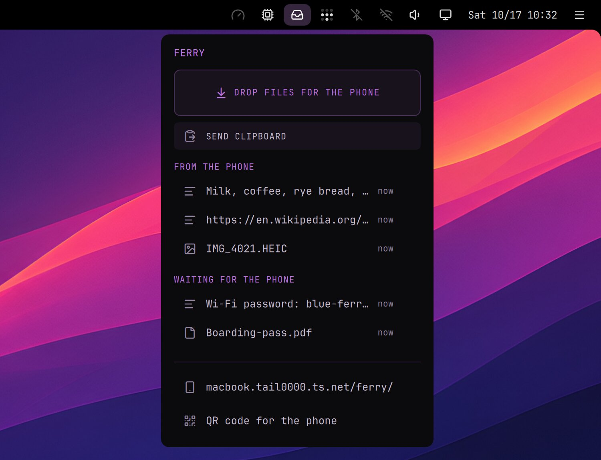

# Ferry

A mailbox between your computers and your iPhone (or any phone). Either end leaves photos, files, text or a link in the box, and they wait there until the other end picks them up. Unlike LocalSend, the phone needs no app, and they don't have to be on the same network: Ferry goes over Tailscale, so it works from anywhere.

- On the computer: drop files on the inbox icon in the top bar (holding them over it opens its menu, where you can drop them too), or press Send Clipboard in the menu. The menu lists both directions: a click copies a text or opens a file, a file can be dragged out into another app, and × takes an item out of the box.
- On the phone: a web page you add to the Home Screen. Received has what your computers left there: Copy for a text, Save for a file (the share sheet, with Save Image for a photo). Send takes a text, the clipboard, photos and files. Swipe a card sideways to remove it; Clear empties a list.
- Several computers with Ferry on are one page: Received and Sent list what all of them hold, and the buttons above Send pick where it goes. The page shows each computer by its name: change it in launcher › Settings › Computer name.
- A notification on the computer when the phone sends something, and on the phone when a computer does (Web Push: on an iPhone with iOS 16.4 or later, for the Home Screen app).
- Files from the phone go to your Downloads folder. Everything leaves the box after 7 days; removing an item doesn't delete a file from Downloads.

**On the iPhone**: open the address shown at the bottom of Ferry's menu (or scan its QR code) in Safari, then Share › Add to Home Screen. Open Ferry from the Home Screen and tap Turn on notifications. The first time, Tailscale may need to be allowed to share the computer: if the menu says so, run `sudo tailscale set --operator=$USER` once and turn Ferry on again (`~/.config/hypr/scripts/ferry enable`).

**Who can get in**: only you. The page isn't on the internet (tailscale serve, not Funnel), and it answers only the Tailscale user who owns the computer, even if others share your tailnet. Nothing that arrives is run or opened by itself: files land in Downloads like any download, texts show as plain text, and in the browser only images, video, audio, PDF and plain text open (anything else downloads). It works while the computer is awake and both ends are on Tailscale; when it can't reach a computer, the page says so.

Keep in mind: the phone is the key. If it is lost unlocked with Tailscale on, remove it in Tailscale's admin console. Another user logged in to the same computer could reach Ferry's local port, so it suits a computer that is yours alone. HTTPS certificates put the computer's tailnet name (computer.tailXXXX.ts.net) in public certificate logs.

Experimental. Turn it off with `~/.config/hypr/scripts/ferry disable`.

Needs: the Tailscale plugin, logged in on the computer and on the phone, with HTTPS turned on for the tailnet (Tailscale's admin console › DNS › HTTPS Certificates)
