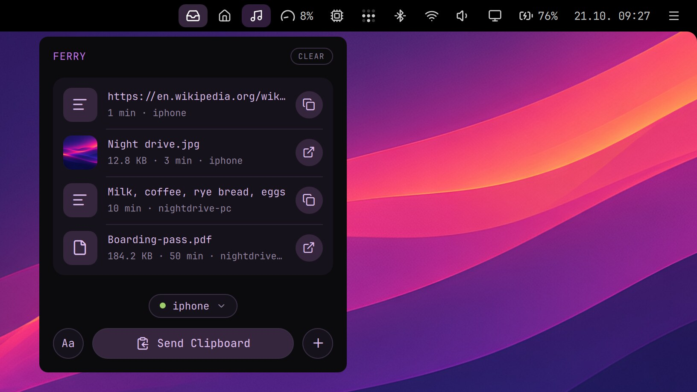

# Ferry

A mailbox between your computers and your phone. Leave photos, files, text or a link at one end, and pick them up at the other. The phone needs no app, and the two don't have to be on the same network: Ferry goes over Tailscale, so it works from anywhere.



## On the computer

- Drop files on the inbox icon in the top bar or in its menu, or press Send Clipboard.
- The menu lists what your other devices sent: a click copies a text or opens a file, and a file drags out into another app.
- Files from the phone go to Downloads, and you get a notification when something arrives.
- Everything leaves the box after 7 days.

## On the phone

Press Add Device in Ferry's menu, scan the QR code (or open the address) in the phone's browser and add the page to the Home Screen. Open Ferry from there and tap Turn on notifications.

- Received has what your computers sent, ready to copy or save; Send takes text, the clipboard (a text, or an image such as a screenshot: iOS doesn't give a page a photo copied from Photos), photos and files.
- With Ferry on several computers, the phone sees them all on one page and picks where each send goes.

If Ferry's menu says Tailscale needs permission, run these once:

```
sudo tailscale set --operator=$USER
ferry enable
```

## In a terminal

The `ferry` command does the same, and `ferry help` lists all of it.

| Command | What it does |
| --- | --- |
| `ferry send [file…]` | Sends files, or a text; with nothing, the clipboard |
| `ferry list` | What's in the box, numbered |
| `ferry get [n]` | An item from the phone (the newest without a number): a text printed, a file saved here |
| `ferry open <n>` | Opens a file |
| `ferry copy <n>` | Copies a text |
| `ferry qr` | The page's QR code, for adding a phone |

## Privacy

Only you can get in. The page isn't on the internet (tailscale serve, not Funnel), and it answers only the Tailscale user who owns the computer. Nothing that arrives is opened or run by itself. The phone is the key: if it's lost unlocked, remove it in Tailscale's admin console. Ferry suits a computer that is yours alone, and its tailnet name (computer.tailXXXX.ts.net) shows in public certificate logs.

Needs: the Tailscale plugin on the computer and the phone, with HTTPS certificates turned on for the tailnet (Tailscale's admin console › DNS)
