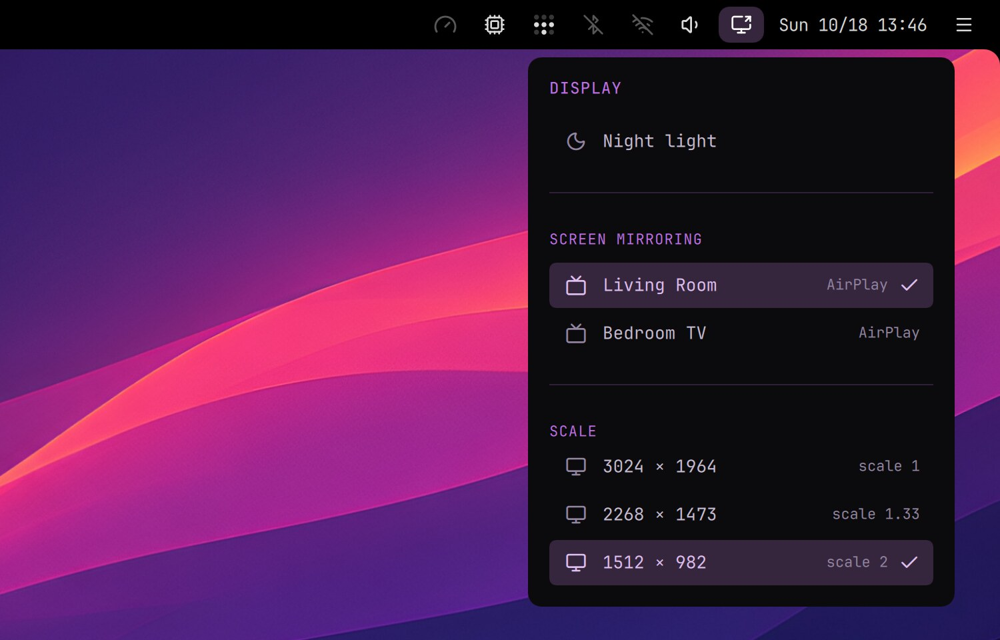

# Screen Mirroring

Mirror your screen to an Apple TV or an AirPlay TV, with sound, as a Mac does. It uses doubletake, an open-source AirPlay sender, built from source by the installer.

- Pick the device in the top bar's display menu, under Screen Mirroring, or in the launcher: search "airplay", or Settings › Display. A click on the device you're mirroring to stops it.
- Then pick what to share: the whole screen or one window. While mirroring, the display icon in the top bar is highlighted.
- The first time, the TV shows a code: the launcher asks for it, and the pairing is remembered.
- Asahi Linux has no hardware video encoder, so the picture is encoded in software and limited to 1080p: expect a short delay, fine for slides and videos, less so for games.
- Google Cast works from Chromium without this plugin (⋮ › Cast…).

Homepage: https://github.com/omarroth/doubletake
Needs: an Apple TV or an AirPlay 2 TV on the same network
