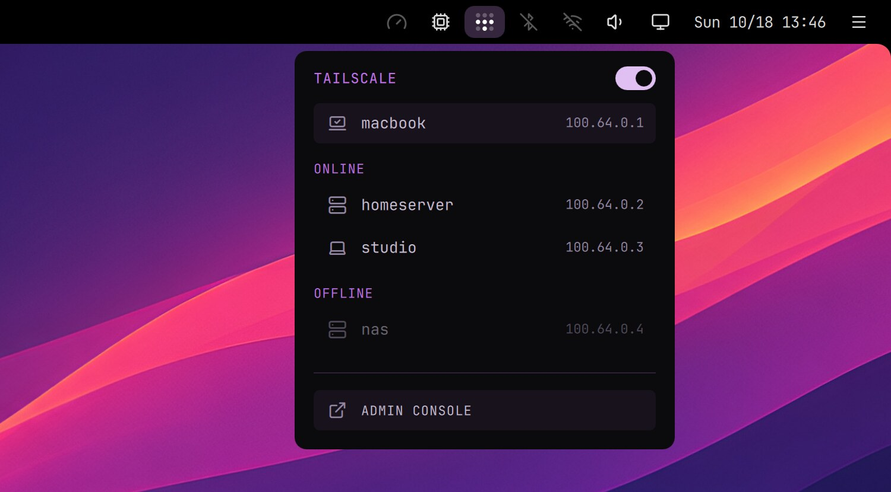

# Tailscale

A private network between your own devices: reach your home server, NAS or Home Assistant from anywhere, as if you were at home.

- The icon in the top bar shows whether you're connected. A right click on it turns Tailscale on or off.
- Its menu has the same switch, this computer and your other devices, online and offline: a click copies a device's address. Admin console opens Tailscale's web console.
- The launcher has it too: Settings › Tailscale.

**In a terminal**: log in once after installing, and let the top bar turn Tailscale on and off without asking for a password.

    sudo tailscale up
    sudo tailscale set --operator=$USER

Homepage: https://tailscale.com
Needs: a Tailscale account (free for personal use)
